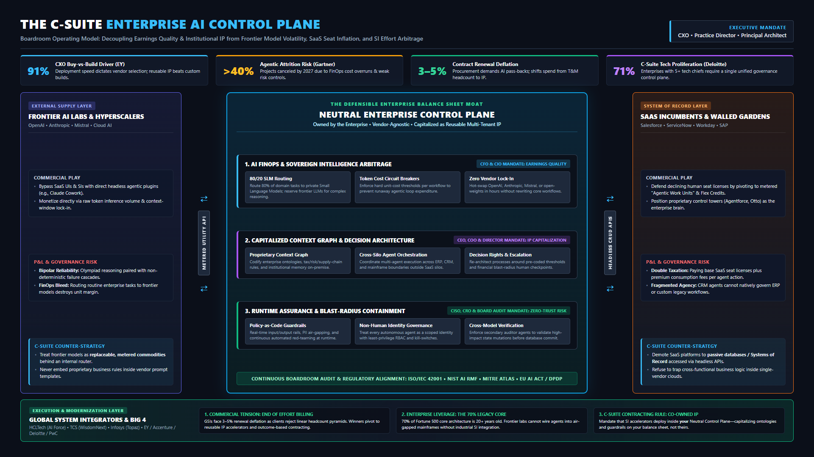
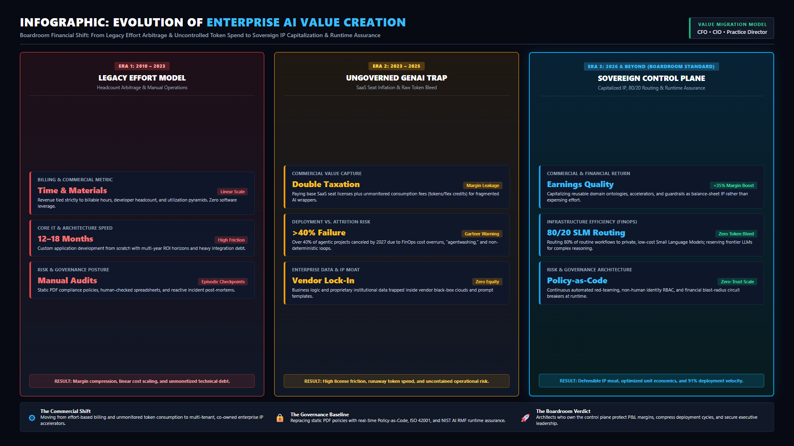

<div align="center">

# The Sovereign Enterprise AI Control Plane & Value Repricing Framework
### Decoupling Enterprise Earnings Quality, Reusable IP, and Runtime Assurance from Frontier Model Volatility, SaaS Seat Inflation, and SI Effort Arbitrage

[](#)
[](LICENSE)
[](#)
[](#)
[](https://github.com/shibinantony)

**A production-ready executive framework, architectural specification, and commercial playbook engineered for Board Directors, CXOs, Practice Leaders, and Principal Enterprise Architects.**

[Executive Summary](#executive-summary) • [The 3-Way War](#the-three-way-stack-war) • [Reference Architecture](#reference-architecture) • [Value Infographic](#evolution-of-enterprise-value) • [Specifications](#framework-specifications) • [Playbooks](#executive-playbooks) • [Whitepaper](#whitepaper)

---

</div>

## Executive Summary

The enterprise technology market has collided with an unprecedented structural paradox. As identified by **Rajiv Memani** (Chairman, EY India, and President, Confederation of Indian Industry 2025–26) in his foreword to *The AIdea of India: Outlook 2026*, modern organizations operate inside a **"Bipolar AI Universe"**:

* **On one side:** Frontier models demonstrate superhuman coding velocity, multi-step agentic planning, and Olympiad-grade mathematical reasoning.
* **On the other side:** Trivial prompt perturbations induce non-deterministic hallucinations, silent state-mutation errors, and unbudgeted inference spend—while hundreds of billions in global hyperscaler infrastructure capex are deployed ahead of verified enterprise EBITDA returns.

According to **Gartner**, while **40% of enterprise software applications** will embed task-specific autonomous agent workflows, **over 40% of agentic AI deployments will be cancelled by 2027** due to runaway FinOps token costs, "agentwashing," and inadequate risk controls.

Beneath these metrics lies an intense commercial battleground: **The Great AI Repricing**—a three-way territorial war between **Frontier AI Labs**, **SaaS Product Incumbents**, and **Global System Integrators (GSIs)**.

The **Sovereign Enterprise AI Control Plane (SEAC-VR)** is an open, vendor-neutral intellectual property (IP) framework engineered to resolve this tension. It enables enterprises to capitalize their own domain ontologies as balance-sheet software assets, master FinOps unit economics via an **80/20 SLM routing policy**, and enforce continuous **Policy-as-Code zero-trust governance** across autonomous agents.

---

## The Three-Way Stack War

```
                  ======================================
                  FRONTIER AI LABS & HYPERSCALERS
                  (OpenAI, Anthropic, Mistral, Palantir)
                  Strategy: Headless API Plugins & Raw Token Volume
                  ======================================
                                    ▲
                                   / \
                                  /   \
                         Tension /     \ Tension
                                /       \
                               v         v
====================================     ====================================
SAAS WALLED GARDENS                      GLOBAL SYSTEM INTEGRATORS (GSIs)
(Salesforce, ServiceNow, SAP, Workday)   (HCLTech, TCS, Infosys, Big 4)
Strategy: "Agentic Work Units" &         Strategy: Reusable IP Platforms &
Defending the Seat License Moat           Outcome Contracts (3-5% Deflation)
====================================     ====================================
```

1. **Frontier AI Labs (Anthropic, OpenAI, Mistral, Palantir):**  
   Releasing headless agentic plugins (e.g., *Claude Cowork*, *Palantir Warp Speed*) that execute workflows directly via background APIs. Their commercial objective is to commoditize both the application GUI and the systems integration layer, capturing enterprise margin through raw token inference volume.
2. **SaaS Incumbents (Salesforce, ServiceNow, Workday, SAP):**  
   Confronting the structural collapse of per-seat licensing. When autonomous agents execute workflows via headless APIs without human interactive logins, paying $250/month per human seat becomes indefensible. SaaS giants are defending their valuations by pivoting to **"Agentic Work Units"** and **"Flex Credits"** (e.g., *Salesforce Agentforce*, *ServiceNow Otto*), exposing enterprises to **Double Taxation** (base seats + variable agent consumption fees).
3. **Global System Integrators (HCLTech, TCS, Infosys, Big 4):**  
   Confronting **3% to 5% structural contract renewal deflation** as enterprise procurement mandates 10% to 15% productivity pass-backs. Tier-1 players are cannibalizing linear Time & Materials (T&M) headcount models to launch codified IP platforms: **HCLTech AI Force 2.0 / AI Foundry**, **TCS WisdomNext** ($2.3B annualized AI pipeline), and **Infosys Topaz**.

---

## Reference Architecture

The **Sovereign Enterprise AI Control Plane** establishes an enterprise-owned, vendor-agnostic boundary between external model utilities and underlying systems of record:

<div align="center">



</div>

### The Three Structural Pillars:

```
+───────────────────────────────────────────────────────────────────────────────────+
|               THE THREE PILLARS OF THE SOVEREIGN CONTROL PLANE                    |
+───────────────────────────────────+───────────────────────────────────────────────+
| 1. AI FinOps & Intelligence       | • 80/20 SLM-to-Frontier Routing: 80% of tasks |
|    Arbitrage                      |   handled by private VPC Small Language Models|
|    (CFO & CIO Mandate)            | • Hard token-cost circuit breakers & loop caps|
|                                   | • Zero vendor lock-in: Hot-swap LLMs in hours |
+───────────────────────────────────+───────────────────────────────────────────────+
| 2. Capitalized Context Graph &    | • Codify enterprise ontologies & domain rules |
|    Institutional IP               | • Cross-silo multi-agent orchestration fabric |
|    (CEO & Director Mandate)       | • Directed Acyclic Graph (DAG) state machine  |
+───────────────────────────────────+───────────────────────────────────────────────+
| 3. Runtime Assurance & Zero-Trust | • Non-Human Identity Governance (Agent RBAC)  |
|    Governance                     | • Policy-as-Code real-time input/output rails |
|    (CISO & CRO Mandate)           | • Cross-Model Dual-Verification & Audit Agents|
+───────────────────────────────────+───────────────────────────────────────────────+
```

---

## Evolution of Enterprise Value

How enterprise value creation, risk posture, and commercial metrics transition across three technological eras:

<div align="center">



</div>

### Value Matrix Summary:

| Era | Commercial Billing Metric | IT & Deployment Speed | Risk & Governance Posture | Bottom-Line Financial Result |
| :--- | :--- | :--- | :--- | :--- |
| **Era 1: Legacy Effort Model** *(2010–2023)* | **Time & Materials (T&M)**<br>Linear headcount scale | **12–18 Months**<br>High custom build debt | **Manual Audits**<br>Episodic static checkpoints | Margin compression & unmonetized technical debt |
| **Era 2: Ungoverned GenAI Trap** *(2023–2025)* | **Double Taxation**<br>SaaS seats + token bleed | **>40% Attrition Risk**<br>Gartner project cancellation | **Fragmented Clouds**<br>Uncontrolled black-box loops | Margin leakage & uncontained operational liability |
| **Era 3: Sovereign Control Plane** *(2026+)* | **Earnings Quality (EQ)**<br>Capitalized reusable IP | **91% Velocity (EY)**<br>Pre-hardened domain IP | **Policy-as-Code**<br>Zero-trust machine RBAC | **+35% Margin expansion** & defensible corporate moat |

---

## Repository Structure

```
├── README.md                                  # Executive Flagship Documentation & Overview
├── LICENSE                                    # Apache 2.0 Open Architecture License
├── CITATION.cff                               # Academic & Professional Citation Metadata
├── infographics/                              # High-Resolution Architectural Renders
│   ├── csuite_control_plane.html              # Interactive HTML/CSS Control Plane Spec
│   ├── csuite_control_plane.png               # 1920x1080 High-Res Executive Architecture
│   ├── value_infographic.html                 # Interactive HTML/CSS Value Evolution Spec
│   └── value_infographic.png                  # 1920x1080 High-Res Value Migration Matrix
├── articles/                                  # Executive Thought Leadership & Distribution
│   ├── linkedin_csuite_article.md             # 750-word C-Suite Master Article (Ready to Publish)
│   └── executive_carousel_script.md           # 10-Slide PDF Carousel Hook & Visual Spec
├── spec/                                      # Complete Architectural Specifications
│   ├── 01_executive_charter.md                # The Bipolar AI Universe & Three-Way Stack War
│   ├── 02_commercial_value_repricing.md       # Earnings Quality, Contract Deflation & 80/20 FinOps
│   ├── 03_sovereign_control_plane_architecture.md # Reference Topology & Subsystem Blueprint
│   ├── 04_runtime_assurance_zero_trust.md     # Non-Human Identity, Policy-as-Code & Circuit Breakers
│   └── 05_decision_rights_operating_model.md  # 5-Chief C-Suite (CIO/CTO/CDAO/CISO/CAIO) & GCCs
├── playbooks/                                 # Implementation & Diagnostic Playbooks
│   ├── vendor_negotiation_playbook.md         # SaaS "Double-Taxation" & GSI SOW Contract Clauses
│   ├── boardroom_presentation_deck.md         # 10-Slide Board & Investment Committee Script
│   └── cxo_readiness_assessment.md            # 25-Point Diagnostic Scorecard & Maturity Matrix
└── whitepaper/                                # Definitive Industry Research Synthesis
    └── whitepaper_recoding_enterprise_core.md # 20-Page Comprehensive Executive Whitepaper
```

---

## Framework Specifications

* **[Spec 01: Executive Charter & The Three-Way Stack War](spec/01_executive_charter.md):** The macroeconomic collision between Frontier Model Labs, SaaS Walled Gardens, and Global System Integrators.
* **[Spec 02: Commercial Value Repricing & Earnings Quality](spec/02_commercial_value_repricing.md):** Managing 3%–5% contract deflation, transitioning from T&M headcount to capitalized IP, and the 80/20 SLM unit economic model.
* **[Spec 03: Sovereign Control Plane Architecture](spec/03_sovereign_control_plane_architecture.md):** Deep technical reference architecture covering the Model Abstraction Router, Capitalized Context Graph, DAG Orchestration Fabric, and Cross-Model Dual-Verification.
* **[Spec 04: Runtime Assurance & Zero-Trust Governance](spec/04_runtime_assurance_zero_trust.md):** Non-Human Identity Governance (NHIG), Agent Identity Passports (AIP), blast-radius circuit breakers, and alignment with ISO/IEC 42001, NIST AI RMF, and MITRE ATLAS.
* **[Spec 05: Decision Rights & C-Suite Operating Model](spec/05_decision_rights_operating_model.md):** Managing the 5-Chief C-Suite (CIO, CTO, CDAO, CISO, CAIO), shifting from tasks to decision rights (Accenture/Deloitte consensus), and transforming Indian GCCs into global IP foundries (58% agentic adoption).

---

## Executive Playbooks

* **[Vendor Negotiation Playbook](playbooks/vendor_negotiation_playbook.md):** Contractual redlines, anti-double-taxation clauses for SaaS renewals, and mandatory AI productivity pass-back language for GSI Statements of Work.
* **[Boardroom Presentation Deck Script](playbooks/boardroom_presentation_deck.md):** Complete 10-slide script with executive talking points for board meetings and investment committees.
* **[CXO Diagnostic Scorecard](playbooks/cxo_readiness_assessment.md):** 25-question diagnostic matrix scoring commercial economics, FinOps arbitrage, institutional moat, zero-trust governance, and operating alignment.

---

## Whitepaper

Read the full 20-page foundational whitepaper:  
📖 **[Recoding the Enterprise Core: Navigating the Bipolar AI Universe, The Great Commercial Repricing, and The Sovereign Control Plane](whitepaper/whitepaper_recoding_enterprise_core.md)**

---

## Strategic Citations & Research Corpus

This framework synthesizes and builds upon executive research across the industry:
* **EY India & Rajiv Memani:** *The AIdea of India: Outlook 2026*, *Recoding the Core*, *AI is Redefining IT Services, But Earnings Quality is the Real Test*, and *Agentic AI Governance*.
* **Gartner:** Research on Enterprise Agentic AI Attrition Risks and Embedded Application Proliferation (2025–2027).
* **Accenture:** *Operating Model in the Age of AI* (Task execution vs. Decision rights).
* **Deloitte:** *Rewiring the Enterprise Operating Model* (C-suite technology leadership proliferation).
* **PwC:** *AI Business Predictions* (Centralized AI Studios and cross-model validation).
* **Regulatory Standards:** ISO/IEC 42001 (AIMS), NIST AI RMF 1.0, MITRE ATLAS (Adversarial AI Mitigation), EU AI Act (Title III/IV), and India Digital Personal Data Protection Act (DPDP 2023).

---

## Citation & Academic Reference

If you incorporate this framework, reference architecture, or commercial models into corporate strategies, academic papers, or analyst briefings, please cite as:

```bibtex
@misc{boban2026sovereign,
  author = {Boban, Shibin Antony},
  title = {The Sovereign Enterprise AI Control Plane and Value Repricing Framework (SEAC-VR)},
  year = {2026},
  publisher = {GitHub},
  howpublished = {\url{https://github.com/shibinantony/AI_Value_Repricing}}
}
```

---

## License

Copyright © 2026 **Shibin Antony Boban**.  
Licensed under the **[Apache License, Version 2.0](LICENSE)**.
